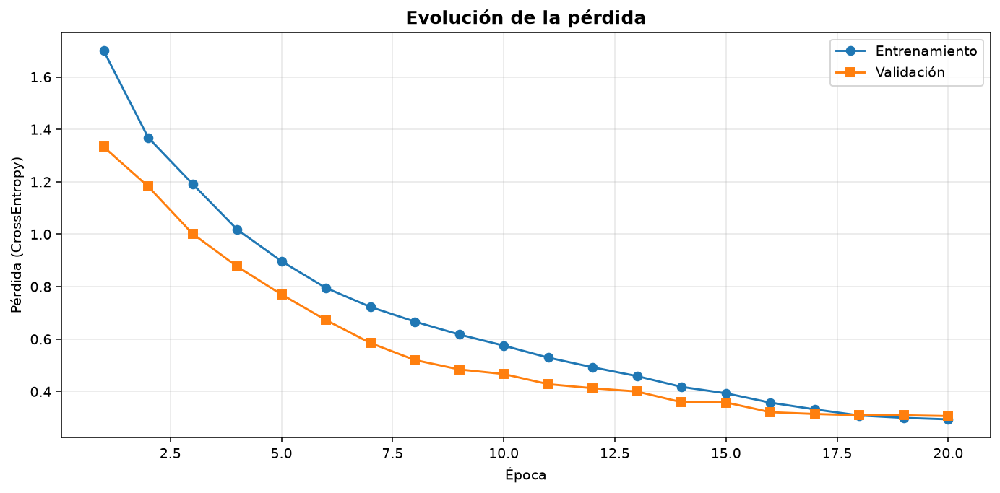
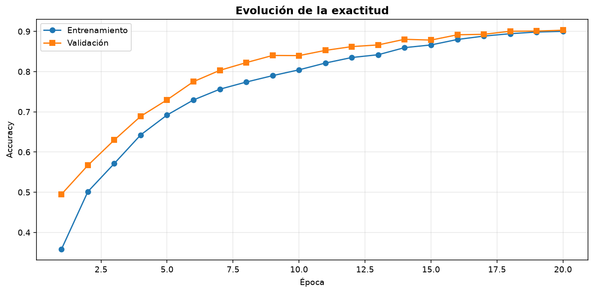
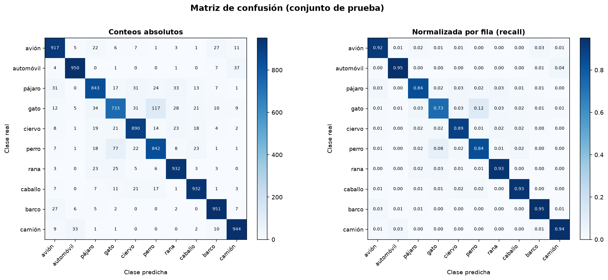
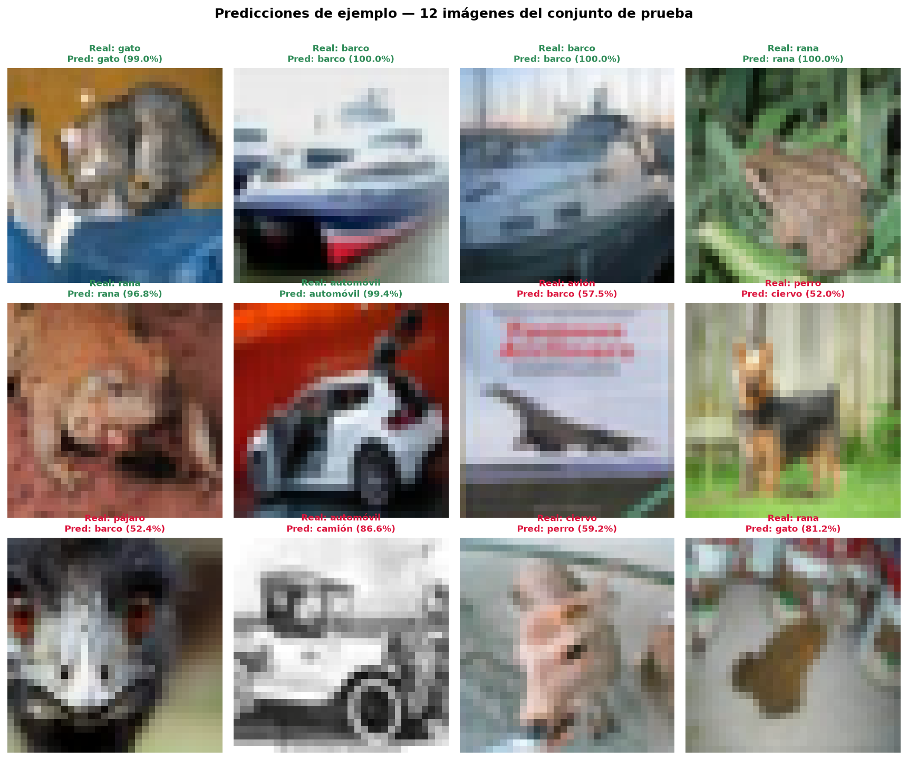
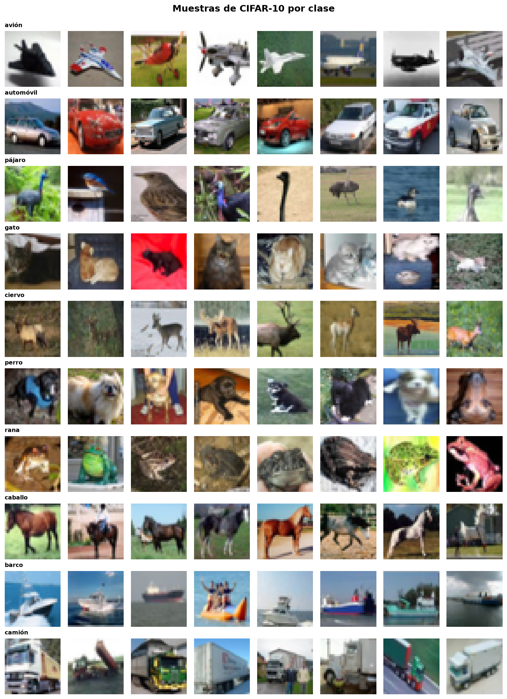
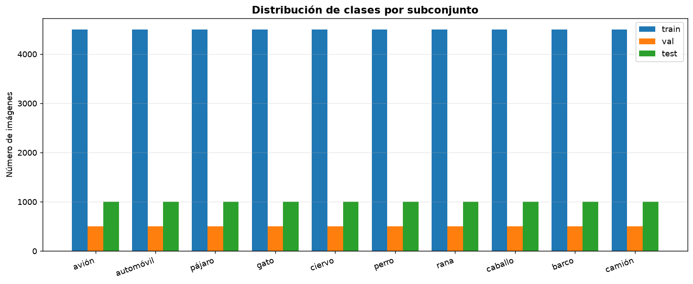
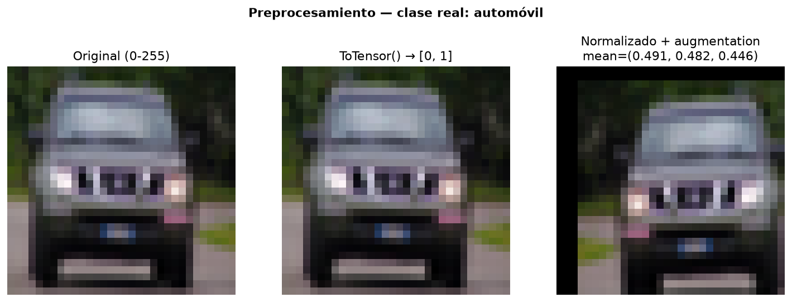

# 🧠 Red Neuronal Convolucional (CNN) para clasificación de imágenes — CIFAR-10

Proyecto completo de **Deep Learning**: una Red Neuronal Convolucional entrenada desde cero
para clasificar imágenes en 10 categorías, con dataset documentado, exploración visual,
preprocesamiento, división estratificada, data augmentation, evaluación con métricas,
matriz de confusión, predicciones de ejemplo, **notebook de experimentación para Google Colab**,
**aplicación web en Streamlit** y especificación funcional mediante **OpenSpec**.

> **Repositorio:** https://github.com/Alejo0916/Red_Neuronal_Convolucional
> **Aplicación:** Streamlit · **Notebook:** Google Colab · **Especificación:** OpenSpec

---

## 📑 Índice

1. [Objetivo](#-objetivo)
2. [Dataset](#-dataset)
3. [Arquitectura de la CNN](#-arquitectura-de-la-cnn)
4. [Estructura del repositorio](#-estructura-del-repositorio)
5. [Instalación](#-instalación)
6. [Ejecución paso a paso](#-ejecución-paso-a-paso)
7. [Resultados obtenidos](#-resultados-obtenidos)
8. [Aplicación de Streamlit](#-aplicación-de-streamlit)
9. [Notebook de Google Colab](#-notebook-de-google-colab)
10. [Especificación con OpenSpec](#-especificación-con-openspec)
11. [Pruebas y CI](#-pruebas-y-ci)
12. [Troubleshooting](#-troubleshooting)
13. [Licencia](#-licencia)

---

## 🎯 Objetivo

Construir un clasificador de imágenes que, dada una imagen arbitraria, determine a cuál de
las 10 clases de CIFAR-10 pertenece y con qué nivel de confianza.

El proyecto cubre el ciclo completo de un sistema de visión por computador:

| Etapa | Entregable en el repositorio |
|---|---|
| Selección y descripción del dataset | `src/data.py`, sección [Dataset](#-dataset) |
| Exploración y visualización | `reports/figures/01_muestras_por_clase.png`, `02_distribucion_clases.png` |
| Preprocesamiento y normalización | `src/data.py` (`build_transforms`, `compute_channel_stats`) |
| División train / val / test | `src/data.py` (`stratified_split`) |
| Data augmentation | `src/data.py` (`build_transforms`, solo en train) |
| Construcción y entrenamiento de la CNN | `src/model.py`, `src/train.py` |
| Métricas de evaluación | `src/evaluate.py`, `reports/metrics.json` |
| Gráficas del entrenamiento | `reports/figures/04_perdida_entrenamiento.png`, `05_accuracy_entrenamiento.png` |
| Matriz de confusión | `reports/figures/06_matriz_confusion.png` |
| ≥ 10 predicciones con imágenes | `reports/figures/08_predicciones_ejemplo.png`, `reports/predictions.json` |
| Guardado del modelo entrenado | `models/cnn_cifar10.pt`, `models/metadata.json` |
| Aplicación web de predicción | `app/app.py` |
| Notebook de experimentación | `notebooks/experimentacion_cifar10_cnn.ipynb` |

---

## 📊 Dataset

**CIFAR-10** — *Learning Multiple Layers of Features from Tiny Images* (Krizhevsky, 2009).

| Propiedad | Valor |
|---|---|
| Imágenes | 60 000 |
| Resolución | 32 × 32 píxeles, RGB (3 canales) |
| Clases | 10 (avión, automóvil, pájaro, gato, ciervo, perro, rana, caballo, barco, camión) |
| Entrenamiento (oficial) | 50 000 (6 000 por clase) |
| Prueba (oficial) | 10 000 (1 000 por clase) |
| Balance | Perfectamente balanceado |
| Licencia | Uso académico libre — <http://www.cs.toronto.edu/~kriz/cifar.html> |

**¿Por qué CIFAR-10?**

- Es el *benchmark* de referencia para redes convolucionales: imágenes de baja resolución
  que permiten entrenar una CNN profunda en minutos y analizar con detalle su comportamiento.
- Cubre problemas reales de un sistema de visión: **variabilidad intra-clase** (un "gato"
  puede ser de myriados colores y poses), **confusión inter-clase** (`gato`↔`perro`,
  `automóvil`↔`camión`, `barco`↔`avión`) y **variaciones de iluminación y fondo**.
- Es de dominio público y se descarga automáticamente, sin credenciales.

### División usada en el proyecto

| Subconjunto | Tamaño | Origen | Uso |
|---|---:|---|---|
| **Entrenamiento** | 45 000 | 90 % del train oficial (estratificado) | Actualizar los pesos |
| **Validación** | 5 000 | 10 % del train oficial (estratificado) | Elegir el checkpoint y ajustar hiperparámetros |
| **Prueba** | 10 000 | Test oficial, **intacto** | Evaluación final |

La división es **estratificada** (`StratifiedShuffleSplit`, `random_state=42`): cada clase
mantiene su proporción dentro de ± 0.3 %. El conjunto de prueba **nunca** se usa para tomar
decisiones (ni para elegir época, ni para ajustar learning rate).

### Preprocesamiento y normalización

```
uint8 [0, 255]
   │  ToTensor()                       → float32 [0, 1], formato CHW
   │  Normalize(mean, std) por canal   → (x - media) / desviación
   ▼
tensor (3, 32, 32) listo para la red
```

Las estadísticas se calculan **exclusivamente sobre las 45 000 imágenes de entrenamiento**
(`mean ≈ (0.4911, 0.4821, 0.4464)`, `std ≈ (0.2469, 0.2434, 0.2616)`) y se reutilizan en
validación, prueba e inferencia. Esto evita fuga de información y garantiza que la app
normalice exactamente igual que el entrenamiento.

### Data augmentation (solo en entrenamiento)

| Transformación | Justificación |
|---|---|
| `RandomCrop(32, padding=4)` | Simula translaciones: el objeto puede estar desplazado en el encuadre real. |
| `RandomHorizontalFlip()` | Los objetos son en general simétricos; amplía el dataset sin alterar la etiqueta. |

La validación y la prueba **no** llevan augmentation: las métricas deben medir el modelo
sobre las imágenes reales, no sobre versiones aleatorias de ellas.

---

## 🏗️ Arquitectura de la CNN

```
Entrada (N, 3, 32, 32)
 │
 ├─ Bloque 1: Conv3x3(3→64)   ▸ BN ▸ ReLU ▸ Conv3x3(64→64)  ▸ BN ▸ ReLU ▸ MaxPool ▸ Dropout2d(0.15)  → (N, 64, 16, 16)
 ├─ Bloque 2: Conv3x3(64→128) ▸ BN ▸ ReLU ▸ Conv3x3(128→128)▸ BN ▸ ReLU ▸ MaxPool ▸ Dropout2d(0.15)  → (N, 128, 8, 8)
 ├─ Bloque 3: Conv3x3(128→256)▸ BN ▸ ReLU ▸ Conv3x3(256→256)▸ BN ▸ ReLU ▸ MaxPool ▸ Dropout2d(0.15)  → (N, 256, 4, 4)
 ├─ Global Average Pooling                                                                      → (N, 256)
 ├─ Dropout(0.5) ▸ Linear(256 → 10)                                                              → (N, 10) logits
```

**Decisiones de diseño**

- **BatchNorm** tras cada convolución: estabiliza la distribución de activaciones y permite
  usar learning rates más altos.
- **Dropout2D** en los bloques (desactiva mapas de activación completos) y **Dropout** en la
  cabeza: regularización frente al sobreajuste.
- **Global Average Pooling** en lugar de `Flatten`: reduce la cabeza de ~330 000 a 2 570
  parámetros y evita el sobreajuste.
- La red devuelve **logits**; el `softmax` se aplica en la pérdida (`CrossEntropyLoss`) y en
  la inferencia.

**Parámetros entrenables:** 1 148 874 (≈ 1.15 M).

### Entrenamiento

| Hiperparámetro | Valor |
|---|---|
| Optimizador | `AdamW` (`lr = 1e-3`, `weight_decay = 5e-4`) |
| Scheduler | `OneCycleLR` (`max_lr = 1e-2`, warmup 30 %, annealing coseno) |
| Pérdida | `CrossEntropyLoss` |
| Épocas | 20 |
| Batch size | 128 |
| Gradient clipping | 5.0 (norma L2) |
| Semilla | 42 (Python, NumPy y PyTorch) |
| Selección del modelo | Checkpoint con mayor accuracy de **validación** |

---

## 📁 Estructura del repositorio

```
Red_Neuronal_Convolucional/
├── app/
│   ├── app.py                      # Aplicación Streamlit
│   └── assets/examples/            # 12 imágenes de ejemplo del dataset
├── models/
│   ├── cnn_cifar10.pt              # Pesos del modelo entrenado (~4.6 MB)
│   └── metadata.json               # Configuración, normalización, métricas
├── notebooks/
│   └── experimentacion_cifar10_cnn.ipynb   # Notebook Colab con salidas reales
├── reports/
│   ├── figures/                    # 8 figuras PNG
│   ├── history.json                # Historial por época
│   ├── metrics.json                # Métricas de prueba + informe por clase
│   └── predictions.json            # ≥ 10 predicciones de ejemplo
├── src/
│   ├── __init__.py
│   ├── config.py                   # Rutas, clases, hiperparámetros
│   ├── data.py                     # Dataset, splits, transforms, exploración
│   ├── model.py                    # Arquitectura CNN
│   ├── train.py                    # Bucle de entrenamiento + CLI
│   ├── evaluate.py                 # Métricas, figuras, matriz de confusión
│   ├── predict.py                  # Inferencia (carga del modelo + predicción)
│   └── utils.py                    # Semillas, dispositivo, JSON, logging
├── tests/
│   └── test_pipeline.py            # 24 pruebas unitarias
├── tools/
│   ├── build_notebook.py           # Generador del notebook de Colab
│   ├── check_notebook.py           # Comprobación de sintaxis del notebook
│   ├── check_notebook_errors.py    # Comprobación de errores en las salidas
│   ├── download_cifar10.py         # Descarga reanudable de CIFAR-10
│   ├── export_examples.py          # Exporta imágenes de ejemplo para la app
│   ├── notebook_summary.py         # Resumen de las salidas del notebook
│   ├── smoke_test.py               # Prueba de humo del pipeline
│   └── update_readme_results.py    # Inyecta los resultados en el README
├── openspec/
│   ├── config.yaml                 # Configuración de OpenSpec (idioma: es)
│   ├── specs/                      # Requisitos duraderos publicados (6 capacidades)
│   └── changes/archive/            # Historial de cambios archivados
├── .github/workflows/ci.yml        # Integración continua
├── requirements.txt
├── README.md
└── LICENSE
```

---

## ⚙️ Instalación

**Requisitos:** Python 3.10 o superior (probado en 3.11 y 3.13).

```bash
# 1. Clonar el repositorio
git clone https://github.com/Alejo0916/Red_Neuronal_Convolucional.git
cd Red_Neuronal_Convolucional

# 2. Crear el entorno virtual
python -m venv .venv
.venv\Scripts\activate        # Windows
source .venv/bin/activate     # Linux / macOS

# 3. Instalar PyTorch (elige la variante según tu hardware)
pip install torch torchvision --index-url https://download.pytorch.org/whl/cpu   # CPU
pip install torch torchvision --index-url https://download.pytorch.org/whl/cu121 # CUDA 12.1

# 4. Instalar el resto de dependencias
pip install -r requirements.txt
```

> El proyecto funciona **sin GPU**: en una CPU de 12 hilos el entrenamiento completo
> (20 épocas) tarda aproximadamente **75 minutos**. Con GPU en Colab, unos 10 minutos.

---

## 🚀 Ejecución paso a paso

### 1. Descargar el dataset

```bash
python tools/download_cifar10.py
```

Descarga `cifar-10-python.tar.gz` (≈ 170 MB) desde la Universidad de Toronto **con
reanudación por rangos HTTP**, de modo que una descarga interrumpida continúa donde se
quedó. La descarga también ocurre automáticamente al ejecutar el entrenamiento.

### 2. Explorar el dataset

```bash
python -c "from src.data import explore_dataset; explore_dataset()"
```

Genera en `reports/figures/`: la rejilla de muestras por clase, la distribución de clases
y la comparación del preprocesamiento.

### 3. Entrenar el modelo

```bash
python -m src.train --epochs 20 --device auto
```

Opciones disponibles:

```bash
python -m src.train --help
#  --epochs N            número de épocas (por defecto 20)
#  --batch-size N        tamaño de lote (por defecto 128)
#  --lr FLOAT            learning rate inicial (por defecto 1e-3)
#  --weight-decay FLOAT  decaimiento de pesos de AdamW (por defecto 5e-4)
#  --num-workers N       workers de DataLoader (por defecto 4)
#  --seed N              semilla (por defecto 42)
#  --device auto|cpu|cuda
```

Produce:

- `models/cnn_cifar10.pt` — pesos del mejor checkpoint (según validación)
- `models/metadata.json` — configuración, hiperparámetros, normalización, métricas
- `reports/history.json` — historial completo por época

### 4. Evaluar el modelo

```bash
python -m src.evaluate
```

Genera en `reports/figures/`: la matriz de confusión (conteos y normalizada), las curvas
de entrenamiento y la rejilla de predicciones de ejemplo; y en `reports/`:
`metrics.json` y `predictions.json`.

### 5. Clasificar una imagen desde la terminal

```bash
python -c "
from PIL import Image
from src.predict import load_model, predict_image

modelo, metadatos = load_model()
prediccion = predict_image(modelo, Image.open('mi_imagen.jpg'))
print(prediccion.class_name, f'{prediccion.confidence:.2%}')
for clase, prob in prediccion.top_k:
    print(f'  {clase:12s} {prob:.2%}')
"
```

### 6. Levantar la aplicación web

```bash
streamlit run app/app.py
```

La app queda disponible en <http://localhost:8501>.

---

## 📈 Resultados obtenidos

> Entrenamiento real con semilla 42, 20 épocas, CPU (12 hilos), `torch 2.15.0`.

<!-- RESULTADOS:METRICAS -->

### Métricas en el conjunto de prueba (10 000 imágenes)

| Métrica | Valor |
|---|---:|
| **Accuracy** | **0.8934** (89.34%) |
| **Precision** (macro) | 0.8925 |
| **Recall** (macro) | 0.8934 |
| **F1** (macro) | 0.8926 |
| Imágenes evaluadas | 10,000 |

Mejor época de validación: **época 20** con accuracy **0.9030**
(pérdida de validación 0.3064). Entrenamiento completo: 20 épocas.

### Métricas por clase

| Clase | Precision | Recall | F1 | Soporte |
|---|---:|---:|---:|---:|
| avión | 0.8946 | 0.9170 | 0.9057 | 1,000 |
| automóvil | 0.9491 | 0.9500 | 0.9495 | 1,000 |
| pájaro | 0.8673 | 0.8430 | 0.8550 | 1,000 |
| gato | 0.8199 | 0.7330 | 0.7740 | 1,000 |
| ciervo | 0.8838 | 0.8900 | 0.8869 | 1,000 |
| perro | 0.8247 | 0.8420 | 0.8333 | 1,000 |
| rana | 0.9040 | 0.9320 | 0.9178 | 1,000 |
| caballo | 0.9200 | 0.9320 | 0.9260 | 1,000 |
| barco | 0.9314 | 0.9510 | 0.9411 | 1,000 |
| camión | 0.9300 | 0.9440 | 0.9370 | 1,000 |

### Pares de clases más confundidos

| Clase real | Clase predicha | Casos |
|---|---|---:|
| gato | perro | 117 |
| perro | gato | 77 |
| automóvil | camión | 37 |
| gato | pájaro | 34 |
| pájaro | rana | 33 |

### Curvas del entrenamiento

| Pérdida | Accuracy |
|---|---|
|  |  |

### Matriz de confusión



### Predicciones de ejemplo



### Exploración del dataset







<!-- RESULTADOS:FIN -->

---

## 🖥️ Aplicación de Streamlit

```bash
streamlit run app/app.py
```

**Características**

- Carga el modelo entrenado **del repositorio** (`models/cnn_cifar10.pt`) — no hace falta
  reentrenar ni tener el dataset en el equipo.
- Permite **subir una imagen** (JPG, PNG, WEBP, BMP) o usar una de las **12 imágenes de
  ejemplo** incluidas.
- Muestra la **clase predicha** y su **probabilidad** (nivel de confianza), con semáforo
  visual: alta (≥ 80 %), media (≥ 50 %) o baja (< 50 %).
- Muestra la **distribución completa de probabilidades** para las 10 clases.
- Panel lateral con la información del modelo (arquitectura, parámetros, epochs, accuracy
  de validación y de prueba).
- Si el checkpoint no está disponible, muestra un mensaje accionable en lugar de romperse.

**Captura del flujo**

```
1. Elige una imagen   →  📤 Subir imagen   |   🖼️ Usar ejemplo del dataset
2. Predicción         →  🐈 gato           Confianza: 94.31%
                         perro  3.11%
                         ...
```

---

## 📓 Notebook de Google Colab

El notebook [`notebooks/experimentacion_cifar10_cnn.ipynb`](notebooks/experimentacion_cifar10_cnn.ipynb)
está **versionado con sus salidas reales** (figuras, métricas y tablas ya renderizadas) y
es reproducible en Colab:

1. Abre <https://colab.research.google.com/> y sube el `.ipynb` (o `File → Upload notebook`).
2. `Entorno de ejecución → Ejecutar todo`.
3. El notebook detecta automáticamente la GPU y ajusta el dispositivo.

Incluye las 13 etapas del pipeline con explicación en Markdown: dataset, exploración,
preprocesamiento, división, augmentation, arquitectura, entrenamiento, métricas, gráficas,
matriz de confusión, ≥ 10 predicciones, guardado del modelo e inferencia.

El notebook reutiliza el paquete `src/` del repositorio (lo clona automáticamente si no lo
encuentra) para que **no haya dos implementaciones divergentes** del pipeline. Para
reentrenar desde cero en Colab, pon a `True` la bandera `ENTRENAR_DESDE_CERO` de la celda 7.

---

## 📐 Especificación con OpenSpec

El proyecto usa [OpenSpec](https://github.com/Fission-AI/OpenSpec) como capa de
especificación: los **requisitos duraderos** viven en `openspec/specs/` y el **historial de
cambios** en `openspec/changes/archive/`.

```bash
npm install -g @fission-ai/openspec@latest

openspec list                 # cambios en curso
openspec list --specs         # capacidades publicadas
openspec validate --strict    # validar los requisitos
openspec show <capacidad>     # leer una especificación
```

**Capacidades publicadas** (`openspec/specs/`)

| Capacidad | Qué define |
|---|---|
| `data-pipeline` | Dataset, exploración, preprocesamiento, división y augmentation |
| `cnn-training` | Arquitectura, optimización, reproducibilidad y persistencia del modelo |
| `model-evaluation` | Métricas, gráficas, matriz de confusión y predicciones de ejemplo |
| `inference-app` | Comportamiento de la aplicación de Streamlit |
| `experiment-notebook` | El notebook de Colab y su cobertura |
| `project-docs` | README, dependencias, exclusiones y CI |

El cambio que implementa este proyecto está archivado en
`openspec/changes/archive/2026-11-15-cnn-cifar10-clasificador-imagenes/` con su propuesta,
diseño técnico, 6 especificaciones delta y las **39 tareas** de implementación marcadas como
completadas.

**Historial de cambios** (`openspec/changes/archive/`)

| Cambio | Estado | Contenido |
|---|---|---|
| `2026-11-15-cnn-cifar10-clasificador-imagenes` | ✅ Archivado | Propuesta, diseño, 6 especificaciones y las 39 tareas de implementación (todas completadas) |

La especificación se escribió **antes** de implementar el código y se archivó **después** de
verificarlo: cada requisito de `openspec/specs/` tiene su escenario comprobable en
`tests/`.

---

## 🧪 Pruebas y CI

```bash
python -m pytest tests -v
```

24 pruebas cubren: forma de la salida de la red, número de parámetros, determinismo de la
semilla, estratificación y disjointness de la división, presencia de augmentation
**solo** en entrenamiento, inversión de la normalización, errores claros al cargar un
checkpoint ausente o corrupto, suma de probabilidades = 1 y round-trip del checkpoint.

El workflow [`.github/workflows/ci.yml`](.github/workflows/ci.yml) ejecuta en cada push:
importabilidad de `src`, sintaxis de la app, carga y predicción del modelo versionado,
las pruebas unitarias, la validación estricta de OpenSpec y la comprobación de que el
README documenta los comandos principales.

---

## 🔧 Troubleshooting

| Síntoma | Causa probable | Solución |
|---|---|---|
| `No se encontró el modelo entrenado en 'models/cnn_cifar10.pt'` | Falta el checkpoint | Ejecuta `python -m src.train` |
| La descarga del dataset se interrumpe | Red lenta | `python tools/download_cifar10.py` (reanuda) o descarga manual desde [cs.toronto.edu](https://www.cs.toronto.edu/~kriz/cifar.html) |
| `RuntimeError: The default device for CUDA should not be set before initializing` | CUDA mal inicializado | `pip install torch torchvision --index-url https://download.pytorch.org/whl/cu121` y reinicia la terminal |
| El entrenamiento va muy lento | CPU sin aceleración | Reduce `--epochs 5 --num-workers 2` o usa GPU en Colab |
| `DataLoader` se cuelga en Windows | Falta el guard `if __name__ == "__main__":` en scripts propios | Usa los módulos del paquete (`python -m src.train`) |
| La app no encuentra las imágenes de ejemplo | Faltan los assets | `python tools/export_examples.py` |
| La accuracy es ± 0.5 % respecto a la documentada | No determinismo de cuDNN | Es esperable entre CPU y GPU; las semillas están fijadas |

---

## 📄 Licencia

MIT — ver [LICENSE](LICENSE).

---

<div align="center">

**Proyecto de Deep Learning — CNN para clasificación de imágenes**
<sub>PyTorch · CIFAR-10 · Streamlit · OpenSpec</sub>

</div>
